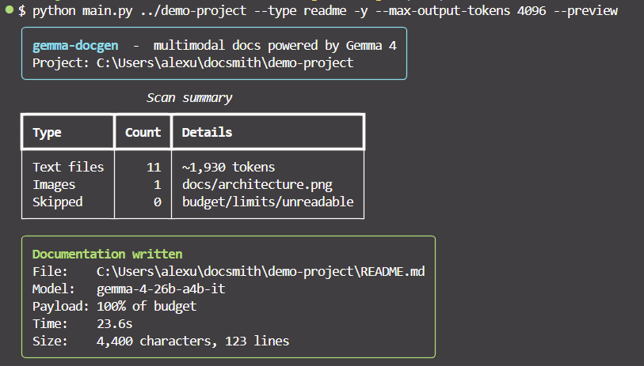
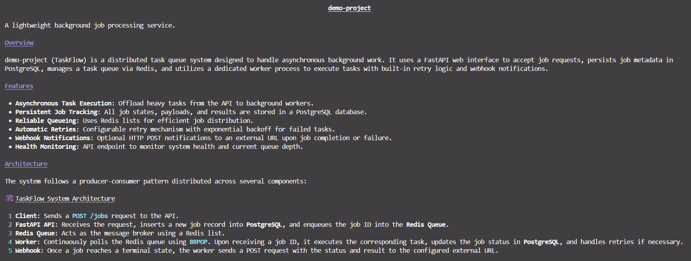
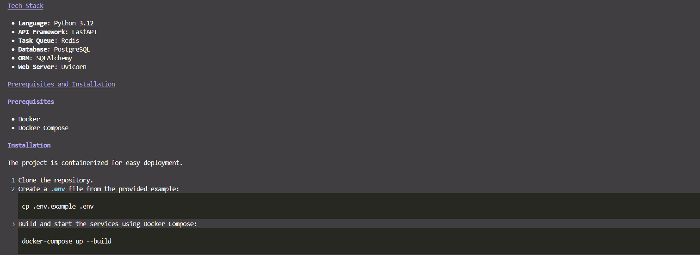
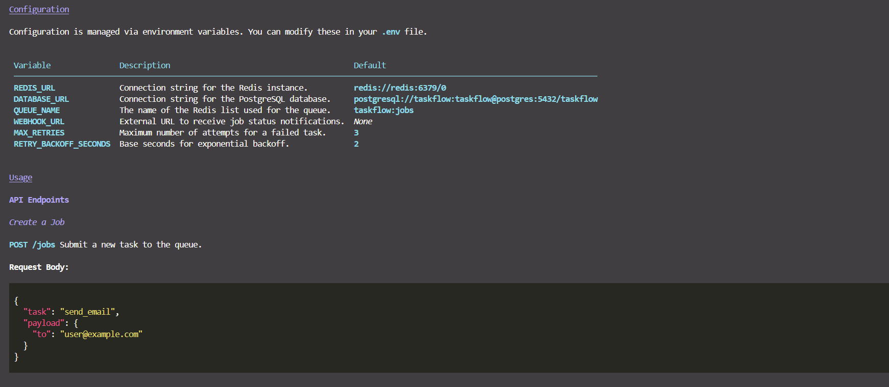
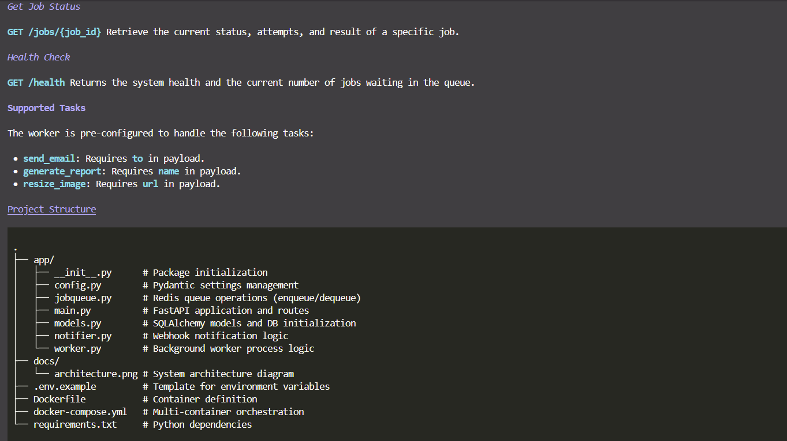

# gemma-docgen

**Multimodal developer CLI documentation assistant, powered by Gemma 4.**

`gemma-docgen` scans a project directory (source code, config files **and**
architecture diagrams or screenshots), sends everything to Google's open-weight
**Gemma 4** model through the Gemini API, and writes structured Markdown
documentation (`README.md` or a deeper `DOCUMENTATION.md`).

## Demo & Output

Here is **gemma-docgen** in action, scanning a project directory containing code and architecture diagrams, then generating structured documentation via Gemma 4:

### 1. Running the CLI


### 2. Generated Markdown Preview




## Why Gemma 4

- **Multimodal input:** diagrams and images are read by the model and explained in the generated docs, then embedded with the correct relative paths.
- **Speed control:** Gemma 4's thinking mode is switched off (`thinking_level="minimal"`) for fast responses, with `--think` to turn it back on for deeper reasoning.
- **Two model sizes:** defaults to the fast `gemma-4-26b-a4b-it` mixture-of-experts model and automatically falls back to the `gemma-4-31b-it` dense model.
- **Open weights, free tier:** runs on a free Google AI Studio API key.

## Features

- Smart scanner: skips `venv`, `node_modules`, `.git`, lockfiles, binaries and real `.env` files
- Secret redaction: obvious API keys and passwords are masked before upload
- Token budget control: prioritises manifests and entry points, truncates huge files
- Streaming output with live progress
- Overload handling: on HTTP 500/503/429 it retries with a smaller payload, then falls back to the other Gemma 4 model

## Setup

Requires Python 3.9+ and a free API key from [Google AI Studio](https://aistudio.google.com/apikey).

```bash
git clone https://github.com/<your-user>/gemma-docgen.git
cd gemma-docgen
python -m venv venv

# Git Bash on Windows:
source venv/Scripts/activate
# PowerShell:      venv\Scripts\Activate.ps1
# macOS / Linux:   source venv/bin/activate

pip install -r requirements.txt
cp .env.example .env      # then paste your key into .env
```

`.env`:

```
GEMINI_API_KEY=your_gemini_api_key_here
```

## Usage

```bash
# Generate DOCUMENTATION.md for the current folder
python main.py .

# Generate a README.md for another project
python main.py ../my-app --type readme

# Fuller documents (default output cap is 1000 tokens for speed)
python main.py ../my-app --max-output-tokens 4096

# Custom output path (relative paths are resolved inside the project folder)
python main.py ../my-app -o docs/OVERVIEW.md

# See what would be sent, without calling the API
python main.py ../my-app --dry-run

# Maximum quality: larger model with thinking enabled
python main.py . --model gemma-4-31b-it --think
```

| Option | Default | Description |
| --- | --- | --- |
| `PATH` | `.` | Project directory to scan |
| `-o, --output` | `DOCUMENTATION.md` / `README.md` | Output file |
| `-t, --type` | `docs` | `docs` (in-depth) or `readme` (concise) |
| `-m, --model` | `gemma-4-26b-a4b-it` | Preferred model, tried first (or set `DOCGEN_MODEL`) |
| `--think` | off | Enable Gemma's thinking mode (slower, deeper) |
| `--max-output-tokens` | `1000` | Cap on generated tokens; raise for longer docs |
| `--max-chars` | `24000` | Total text budget sent to the model |
| `--max-file-kb` | `8` | Per-file size cap before truncation |
| `--max-images` | `2` | Maximum diagrams/images to attach |
| `--no-images` | off | Skip images |
| `--with-gemini` | off | Also allow Gemini Flash models as extra fallbacks |
| `--dry-run` | off | Scan only, no API call |
| `-y, --yes` | off | Overwrite output without asking |
| `--preview` | off | Render the result in the terminal |

### Reading the results box

- **Payload** is everything sent to the model (instructions, file list, file contents, images). `100% of budget` means the first attempt worked at full size; a lower number means the server was overloaded and the request was retried with less.
- **Size** is the generated Markdown: characters and lines.
- **Time** is how long generation took.

## How it works

1. **Scan:** walk the directory, classify files (text / image / ignored), redact secrets.
2. **Prompt:** build one multimodal prompt: file listing, file contents and images.
3. **Generate:** stream a response from Gemma 4 via the `google-genai` SDK, with shrink-and-fallback retries.
4. **Write:** save clean Markdown to disk.

## License

MIT, see [LICENSE](LICENSE).